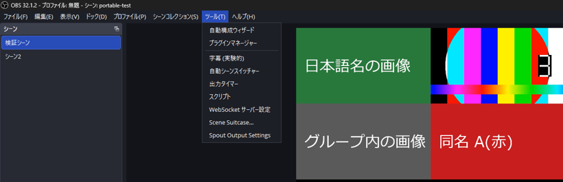
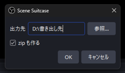
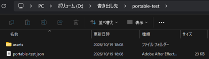
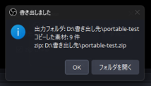
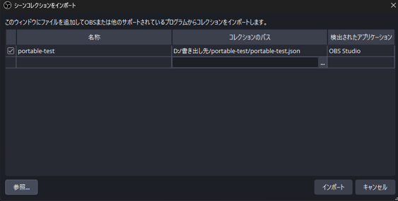

# Scene Suitcase

OBS Studio のシーンコレクションを、素材ファイルごと 1 つのフォルダへ書き出すプラグイン。
書き出したフォルダは、このプラグインを入れていない別の PC の OBS でも、標準の「インポート」だけで開ける。

> OBS Project 公式のものではない、第三者が作った非公式のプラグインです。
> This is an unofficial third-party plugin. It is not made or endorsed by the OBS Project.

English version: [English](#english)

## 何ができるか

OBS 標準の「シーンコレクション」→「エクスポート...」は JSON ファイルだけを書き出す。
素材は元の PC の場所を指したままなので、別の PC で読み込むと素材が全部「見つからない」になる。

Scene Suitcase は次のことを 1 回の操作で行う。

- いま開いているシーンコレクションの素材を、出力先の `assets` フォルダへコピーする
- JSON の中の素材の参照を `./assets/...` に書き換える。受け取った側の OBS は、読み込んだ JSON があるフォルダを基準に素材を探す
- 書き出す前に OBS に保存させるので、保存していない直前の変更も書き出しに入る
- 必要なら zip も同時に作る。日本語のファイル名も化けない

対象の素材は、画像、メディア(動画と音声)、画像スライドショー、スティンガー(トランジション)、画像マスクなどのフィルタ、グループの中のソース、テキストの「ファイルからの読み取り」、ブラウザソースの「ローカルファイル」、VLC ビデオソースのプレイリスト。

## 動作環境

| 項目 | 内容 |
|---|---|
| OS | Windows(64 ビット)のみ。macOS 版と Linux 版は無い |
| OBS Studio | 31 以降。書き出しは 31.1.1 と 32.1.2、受け取り側のインポートは 32.1.2 と 32.2.2 で確かめた |
| 受け取る側 | OBS だけでよい。このプラグインは要らない |

OBS 30 以前には読み込まれない(OBS 31.1.1 に合わせてビルドしているため)。

## 導入(Windows)

配布物は [Releases](../../releases) にある `scene-suitcase-0.1.0-windows-x64.zip`。
展開すると `scene-suitcase` フォルダの中に `bin\64bit\scene-suitcase.dll` と `data` フォルダがある。
同じフォルダの `LICENSE` はライセンス文(GPL-2.0)で、導入ではコピーしなくてよい(0.1.0 の zip には入っていない)。

1. OBS を終了する。
2. `scene-suitcase\bin\64bit\scene-suitcase.dll` を `C:\Program Files\obs-studio\obs-plugins\64bit\` にコピーする。
3. `C:\Program Files\obs-studio\data\obs-plugins\` の中に `scene-suitcase` フォルダを作り、zip の `scene-suitcase\data\` の中身(`locale` フォルダ)をそこへコピーする。
   コピー後は `C:\Program Files\obs-studio\data\obs-plugins\scene-suitcase\locale\` がある状態になる。
4. OBS を起動し、「ツール」メニューに「Scene Suitcase…」があることを確かめる。

- `C:\Program Files` へコピーするときは、管理者の許可を求められる。許可して進める。
- OBS を別の場所にインストールしている場合は、`C:\Program Files\obs-studio` をそのフォルダに読み替える。
- `%APPDATA%\obs-studio\plugins\` に置く方法は、Windows の OBS では読み込まれない(macOS と Linux の置き場所)。
  zip の中のフォルダの形がその置き場所と同じなので、取り違えやすい。

「ツール」メニューに出ないときは、OBS の「ヘルプ」→「ログファイル」→「現在のログを表示」を開き、`Loaded Modules:` の一覧に `scene-suitcase.dll` があるかを見る。
無ければ、手順 2 のコピー先が違っている。

削除するときは、手順 2 でコピーした `scene-suitcase.dll` と、手順 3 で作った `data\obs-plugins\scene-suitcase` フォルダを消す。

## 書き出す

1. 書き出したいシーンコレクションを OBS で開いた状態で、「ツール」→「Scene Suitcase…」を選ぶ。

   

2. 「出力先」に書き出し先のフォルダを指定する。「参照…」で選べる。既にあるフォルダを指定しないと「OK」を押せない。
3. zip にまとめて渡したいときは、「zip も作る」にチェックを入れる。

   

4. 「OK」を押す。進捗のダイアログが出る。書き出し中も OBS の画面は固まらない。
5. 終わると「書き出しました」のダイアログが出る。「フォルダを開く」で出力先を開ける。
6. 書き出したフォルダ(または zip)を相手に渡す。

前回の「出力先」と「zip も作る」の選択は、次に開いたときにも残っている。

### 出力の形

```text
<出力先>\
├─ <コレクション名>\
│   ├─ <コレクション名>.json
│   └─ assets\          ← 素材のコピー
└─ <コレクション名>.zip  ← 「zip も作る」を選んだときだけ。中身は上のフォルダと同じ
```



- 出力先に同じ名前のフォルダや zip が既にあるときは、上書きせずに `<コレクション名>_2`、`<コレクション名>_3` の名前で書き出す。既存のファイルは消さない。
- `assets` の中のファイル名は次のように決まる。
  - 画像やメディアのように 1 つのファイルを指す設定は、ソース名に元の拡張子を付けた名前にする(ソース名「背景」が `bg.png` を使っていれば `背景.png`)
  - スライドショーと VLC のプレイリストは、元のファイル名のまま
  - 名前が同じで中身が違うファイルは、`_2` などの連番を付けて両方残す。同じファイルを複数のソースが使っているときは、1 つだけコピーして共有する
  - 長い名前は UTF-8 で 80 バイト以内に切り詰める

### 結果ダイアログ

結果ダイアログには、出力フォルダ、コピーした素材の件数、zip の場所、見つからなかった素材の件数が出る。
見つからなかった素材は、詳細の欄に「ソース名、元のパス、理由(ファイルが無い / フォルダを指している)」の一覧で出る。



見つからなかった素材は、JSON の中で元のパスのまま残る。書き出し自体は最後まで進む。

### 書き出し中に OBS を終了したとき

OBS は書き出しが終わるまで待ってから閉じる。
待っている間は「書き出しが終わるまで待っています。終わると OBS が閉じます…」の窓が出る。素材が多いと数分かかる。
この間に OBS を強制終了すると、書き出し途中のファイルが残る。

## 受け取った側で開く

受け取る側の OBS に、このプラグインは要らない。

1. 受け取ったフォルダを、`C:\OBS素材\` のような浅いフォルダに置く。zip で受け取ったときは、そこへ展開する。
2. OBS の「シーンコレクション」→「インポート...」を選ぶ。
3. 「シーンコレクションをインポート」の画面で「参照...」を押し、受け取ったフォルダの中の `<コレクション名>.json` を選ぶ。
4. 一覧に追加された行にチェックが入っていることを確かめ、「インポート」を押す。

   

5. 「シーンコレクション」メニューから、インポートしたコレクションを選ぶ。

インポートすると、OBS は `./assets/...` の参照を、読み込んだ JSON があるフォルダを基準にした場所へ置き換える。
インポートした後でこのフォルダを移動したり消したりすると、素材が見つからなくなる。置き場所を決めてからインポートする。

> [!IMPORTANT]
> **受け取ったフォルダは浅い場所に置く。** 深いフォルダに置くと、名前の長い素材だけが「見つからない」になることがある。
>
> - OBS 標準のインポートは、素材ごとに `<置いたフォルダ>\assets\<素材名>` の場所を作る。この長さが UTF-8 で 511 バイトを超えると、その素材だけが見つからなくなる。日本語は 1 文字 3 バイトになる
> - Windows のパスの上限(259 文字)を超えた場合も同じく失敗する。英数字だけの長いパスではこちらに先に当たる
> - 目安として、置き場所のフォルダのパスを日本語でおよそ 130 文字以内に収める
>
> 一式の全部ではなく一部の素材だけが欠けるので、原因に気づきにくい。
> 起きたときは、フォルダを浅い場所へ移してからインポートをやり直す。

## 制限と既知の問題

- Windows(64 ビット)版だけを配布している。
- 書き換えるのは、OBS 標準のソース、フィルタ、トランジションが素材ファイルに使う設定だけ。他のプラグインのソースやフィルタが独自に持つファイルの設定は書き換えず、元のパスのまま残る。
- ブラウザソースの URL は書き換えない。「ローカルファイル」の HTML はそのファイルだけをコピーし、HTML の中から読み込んでいる画像やスクリプトはコピーしない。
- 画像スライドショーに「フォルダ」を追加している場合、フォルダの中身は集めない。見つからなかった素材の一覧に出る。
- VLC ビデオソースは、パスの書き換えとコピーまでを確かめた。受け取った側での再生は確かめていない。
- 受け取った側で深いフォルダに置くと、名前の長い素材だけが見つからないことがある(「受け取った側で開く」の注意)。
- 結果ダイアログで詳細を開くボタンが、日本語表示でも `Show Details...` のまま。

## Scene Collection Manager との違い

[Scene Collection Manager](https://github.com/exeldro/obs-scene-collection-manager) の書き出しも素材を集めるが、素材の参照を `./` の付かない形で書く。そのため、受け取った側にも同じプラグインが要る。
Scene Suitcase は参照を `./assets/...` の形で書く。OBS 標準のインポートは `./` で始まる参照だけを JSON のある場所を基準に置き換えるので、受け取った側は何も入れずに開ける。

## ライセンス

[GPL-2.0](LICENSE)(OBS Studio に合わせている)

---

## English

Scene Suitcase exports the current OBS scene collection **together with its media files** into one folder.
The other PC can open it with the standard "Import" of plain OBS. The other PC does not need this plugin.

### What it does

OBS's built-in "Scene Collection" → "Export..." saves only the JSON file. Media paths still point to the original PC, so all media is missing on another PC.

Scene Suitcase:

- copies the media of the current scene collection into an `assets` folder
- rewrites the media paths in the JSON to `./assets/...`. On import, OBS resolves these paths relative to the folder of the JSON file
- makes OBS save first, so unsaved changes are included
- can also create a zip. Japanese file names are kept correctly

Covered media: images, media sources (video and audio), image slide shows, stinger transitions, filters such as image masks, sources inside groups, text "read from file", browser source "local file", and VLC video source playlists.

### Requirements

- Windows (64-bit) only. There is no macOS or Linux build.
- OBS Studio 31 or later. Export is tested with 31.1.1 and 32.1.2, and import on the receiving side with 32.1.2 and 32.2.2. OBS 30 and earlier do not load it.
- The receiving PC needs only OBS.

### Install (Windows)

Download `scene-suitcase-0.1.0-windows-x64.zip` from [Releases](../../releases) and extract it.
`scene-suitcase\LICENSE` is the license text (GPL-2.0) and does not need to be copied (the 0.1.0 zip does not include it).

1. Quit OBS.
2. Copy `scene-suitcase\bin\64bit\scene-suitcase.dll` to `C:\Program Files\obs-studio\obs-plugins\64bit\`.
3. Create the folder `C:\Program Files\obs-studio\data\obs-plugins\scene-suitcase\` and copy the contents of `scene-suitcase\data\` (the `locale` folder) into it.
4. Start OBS and check that "Tools" has "Scene Suitcase…".

Windows asks for administrator permission when you copy to `C:\Program Files`. If OBS is installed somewhere else, use that folder instead.
On Windows, OBS does **not** load plugins from `%APPDATA%\obs-studio\plugins\` (that location is for macOS and Linux).

If the menu item is missing, open "Help" → "Log Files" → "View Current Log" and check that `scene-suitcase.dll` is listed under `Loaded Modules:`.

To uninstall, delete `scene-suitcase.dll` and the `data\obs-plugins\scene-suitcase` folder.

### Export

1. With the scene collection open, select "Tools" → "Scene Suitcase…".
2. Set "Output folder". Use "Browse…" to pick an existing folder. "OK" stays disabled until the folder exists.
3. Check "Also create a zip" if you want a zip.
4. Click "OK". A progress dialog appears. OBS stays responsive.
5. When "Export finished" appears, click "Open folder" to open the output.
6. Send the folder (or the zip) to the other person.

The output is `<output folder>\<collection name>\<collection name>.json` and `<output folder>\<collection name>\assets\`. With the zip option, `<output folder>\<collection name>.zip` has the same contents.
If a folder or zip with the same name already exists, Scene Suitcase does not overwrite it and uses `<collection name>_2`, `<collection name>_3`, and so on.

Files that cannot be found keep their original paths in the JSON. The export still finishes, and the result dialog lists them (source name, original path, reason).

If you quit OBS during an export, OBS waits until the export finishes and then closes. A "Waiting for the export to finish…" window is shown meanwhile. Do not force-quit OBS during this time, or half-written files are left behind.

### Open on the other PC

1. Put the received folder in a **short path** such as `C:\OBS\`. If you received a zip, extract it there.
2. In OBS, select "Scene Collection" → "Import...".
3. In "Import Scene Collection", click "Browse..." and select `<collection name>.json`.
4. Make sure the row is checked, and click "Import".
5. Select the imported collection from the "Scene Collection" menu.

After import, OBS refers to the media in that folder. Do not move or delete the folder afterwards.

> [!IMPORTANT]
> Keep the folder path short. OBS's importer fails for a media file when `<folder>\assets\<file name>` is longer than 511 bytes in UTF-8, or longer than 259 characters (the Windows path limit). Only the files with long names go missing, so the cause is easy to miss. If this happens, move the folder to a shorter path and import again.

### Limitations

- Windows (64-bit) only.
- Only settings that the built-in OBS sources, filters, and transitions use for media files are rewritten. File settings of third-party plugin sources and filters keep their original paths.
- Browser source URLs are not changed. For a browser source "local file", only the HTML file is copied, not the files it loads.
- Folders added to an image slide show are not collected. They are listed as missing.
- For VLC video sources, path rewriting and copying are tested. Playback on the receiving PC is not tested.
- The "Show Details..." button in the result dialog is not translated.

Unlike [Scene Collection Manager](https://github.com/exeldro/obs-scene-collection-manager), whose export writes paths without `./` and needs the same plugin on the receiving PC, Scene Suitcase writes `./assets/...` paths that plain OBS can import.

### License

[GPL-2.0](LICENSE), the same as OBS Studio.
